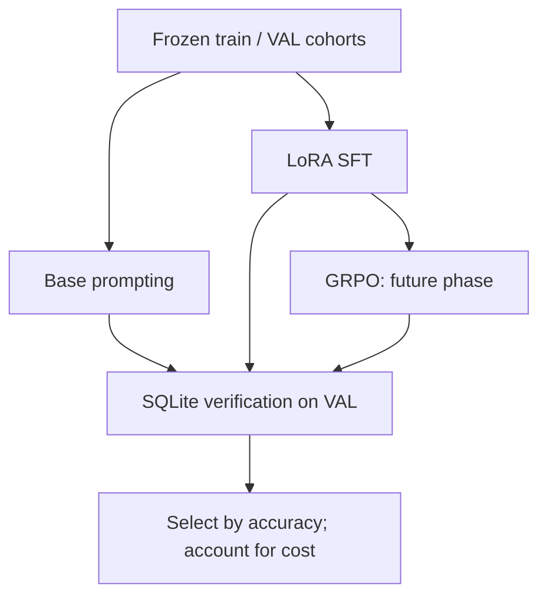

# Execution-rewarded text-to-SQL with GRPO

Study whether execution rewards improve a small Qwen model beyond prompting and LoRA SFT, with auditable costs and reward exploits.

**Work in progress: one complete validation baseline is measured. Few-shot, SFT and hosted comparisons remain incomplete; no RL improvement or released adapter is claimed.** [Saved status](results/project_status.json).

| System | Validation execution accuracy / 95% CI | Measured cost | Status |
|---|---|---|---|
| Base zero-shot | **64.76% [58.68, 70.53]** | Unknown | Complete |
| Base few-shot | Not measured | Unknown | 1,632/2,304 saved; generation resumed |
| Hosted / frontier | Not measured | Unknown | Owner-managed free API credential pending |
| SFT | Not measured | Unknown | No trained checkpoint verified |
| GRPO | Not measured | Unknown | Future Phase 5 |

The measured system is pinned Qwen3-4B-Instruct-2507, NF4/FP16, seed 42, generation batch size 8. On **2,304 questions across 31 held-out databases**, it answers **1,492** correctly under this project's stricter SQLite comparator. The interval uses **2,000 database-cluster bootstrap samples**. These are project VAL results, not official benchmark leaderboard scores. [Raw outputs, config and environment](results/free_runs_batch8_v2/base_zero); [evaluation](results/free_runs_batch8_v2/base_zero_evaluation/summary.json); [recomputed evidence](results/saved_baseline_check_20261118.json).

Valid-SQL rate is **93.84%**, timeout rate **0.35%**, mean output **44.53 tokens**. All **26** gold-query errors remain in the denominator. Difficulty labels are unavailable for this training-derived VAL cohort. Recorded generation latency is shared batch wall time; it must not be presented as isolated per-query latency. Missing costs remain unknown, so cost per accuracy point is not yet available. [Per-question evidence](results/free_runs_batch8_v2/base_zero_evaluation/per_question.jsonl).

Latest CPU verifier suite: **118 passed** ([XML](results/tests-evidence-replay-20261120.xml)); the earlier Colab suite had **111 passed** ([XML](results/colab_import_20261118/tests-resumed-20261118.xml), [GPU/runtime receipt](results/resume_verified_20261118.json)). Train/VAL manifests have zero database/question-hash overlap ([resume audit](results/resume_audit_20261118/summary.json)). The audit records **16,428 source questions**, **57 duplicates removed**, and a shared eligible training pool of **12,908**. Historical gold execution was **15,651/16,371 (95.60%)**, below the near-100% target; all 720 failures are accounted for in the [saved failure analysis](docs/GOLD_QUERY_FAILURE_ANALYSIS.md), with no labels or limits changed. [Data audit](results/data_audit.json), [eligibility](results/training_eligibility.json), [gold audit](results/gold_audit/summary.json).

Planned comparison:



CPU verification in three commands (Python 3.12 and pinned uv):

```bash
uv sync --frozen --extra test --extra data
uv run --no-sync pytest
uv run --no-sync python scripts/verify_saved_baseline.py --output results/reproduction_baseline_check.json
```

The third command verifies imported hashes and recomputes saved metrics and intervals; it does not regenerate answers. [Full reproduction](docs/REPRODUCE.md), [free GPU notebook](notebooks/Free_Phase03_Colab_Batch8_Resume.ipynb), [current continuation](docs/STATUS_20261120.md). The zero cash budget is binding. A free hosted Flash model would be a budget baseline, not evidence of beating the strongest frontier model.

What failed and what remains: [FAILURES.md](docs/FAILURES.md) records environment, export and data-schema problems; [DECISIONS.md](docs/DECISIONS.md) explains evaluation choices. [Cheating analysis](docs/WHAT_THE_MODEL_LEARNED_TO_CHEAT.md) currently concerns anticipated exploits, not learned RL behavior.

Limitations: no completed SFT/RL training seed, possible benchmark contamination, SQLite only, stricter resource-limited metric, and official-dev-as-final-test caveat. Final data remains sealed; final manifest/dedup checks are deferred under that rule ([status](results/project_status.json)).

How I would extend this:

- Finish the frozen few-shot, SFT and hosted comparisons.
- Finalize the reward with counterfactual-database checks.
- Run budget-matched GRPO ablations and multiple seeds.
- Report measured costs, paired differences and concrete exploits.
- Freeze all systems before the single final-test evaluation.

Code: MIT. Dataset terms and primary sources: [data audit](docs/DATA_AUDIT.md).
