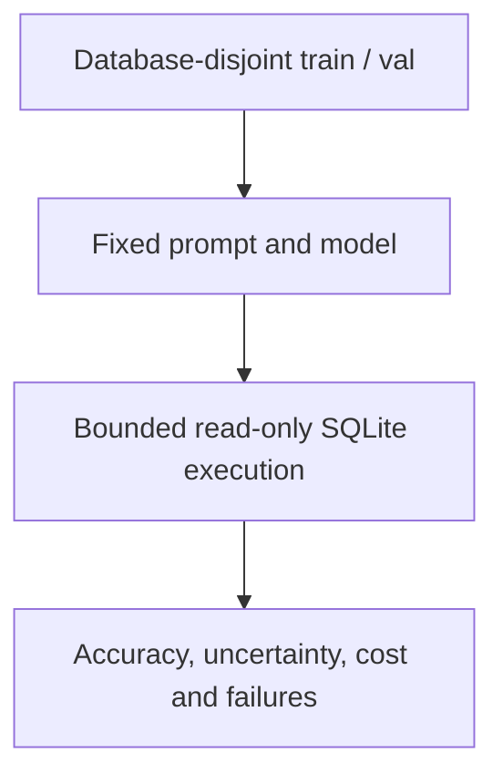

# Execution-rewarded text-to-SQL with GRPO

Study whether execution rewards improve a small Qwen model beyond base prompting and LoRA SFT, with auditable costs and reward exploits.

**Work in progress: Phases 0–3 implementation is present; model benchmark runs and full SFT are blocked. No RL performance or released adapter is claimed.**

Evidence: [project status](results/project_status.json), [tests](results/tests-free-profile-device.xml), [data audit](results/data_audit.json), [gold-query audit](results/gold_audit/summary.json).

| System | Validation accuracy / 95% CI | Training / API cost | Run status |
|---|---|---|---|
| Base zero-shot | Not measured | Not measured | blocked_or_failed |
| Base few-shot | Not measured | Not measured | blocked_or_failed |
| Frontier | Not measured | Not measured | blocked_or_failed |
| SFT | Not measured | Not measured | blocked_or_failed |
| GRPO | Not measured | Not measured | Future Phase 5 |

Missing costs are unknown, not zero. Failure/preflight reasons and configs are saved under [results/runs](results/runs).

Verifier suite: **111 passed**, 0 failures, 0 errors ([fresh saved XML](results/tests-resume-20261118.xml)). [Resume audit](results/resume_audit_20261118/summary.json) verifies train/val manifest hashes and zero database/question-hash overlap; [current handoff](docs/STATUS_20261118.md) distinguishes historical Colab progress from current evidence.
Training annotation audit: **16,428 source questions**; **57 duplicates removed** across project train/val ([audit](results/data_audit.json)).
Gold execution on available databases: **15,651/16,371 (95.60%)**. **0** declared examples lack downloaded databases; all statuses remain in the [audit](results/gold_audit/summary.json).
CPU SFT API integration: **passed** on a random tiny Qwen3 fixture. This is not a benchmark model or accuracy result ([evidence](results/cpu_sft_smoke/status.json)).
Shared SFT/RL/few-shot training pool: **12,908** eligible questions; exclusions and the immutable manifest are recorded in the [eligibility report](results/training_eligibility.json).



CPU reproduction in three commands (Python 3.12, uv 0.13.7):

```bash
uv sync --frozen --extra test --extra data
uv run --no-sync pytest
uv run --no-sync python scripts/synthetic_checks.py --output results/reproduction_synthetic
```

The synthetic check is a verifier demonstration, not model accuracy. [Full data/baseline/SFT reproduction](docs/REPRODUCE.md).

[Run the remaining Phase 2–3 experiment in one command](docs/COMPLETE_PHASE03.md). The runner verifies the frozen data, reports hardware/API blockers before execution, and writes paired comparisons and measured costs only after real model runs succeed.

**Free student route:** [Kaggle notebook](notebooks/Free_Phase03_Kaggle.ipynb) and [setup/limitations](docs/FREE_STUDENT_RUN.md). The separately named free profile uses matching NF4/FP16 base and QLoRA systems, plus a quota-resumable Gemini 3.8 Flash baseline. Actual free GPU/API runs still require authenticated accounts; no benchmark accuracy is claimed.

What failed: [FAILURES.md](docs/FAILURES.md) preserves the initial memory-cap test failure and infrastructure blockers. [Cheating analysis](docs/WHAT_THE_MODEL_LEARNED_TO_CHEAT.md) distinguishes anticipated exploits from learned behavior. [Decisions](docs/DECISIONS.md) explains the stricter comparator and pending final-set audit.

Limitations: unmeasured model performance; no training seeds completed; possible benchmark contamination; SQLite only; official-dev-as-final-test caveat; BIRD database coverage and final-manifest checks remain explicit in the audit. No final test was run ([status](results/project_status.json)).

How I would extend this:

- Run the frozen base and SFT configurations on a CUDA GPU.
- Add a budgeted, versioned frontier baseline.
- Freeze and ablate the GRPO reward after counterfactual-query tests.
- Train GRPO with multiple seeds and select by validation execution accuracy.
- Run the final test once after freezing the complete experiment.

Code: MIT. Dataset terms and primary sources: [data audit](docs/DATA_AUDIT.md).
